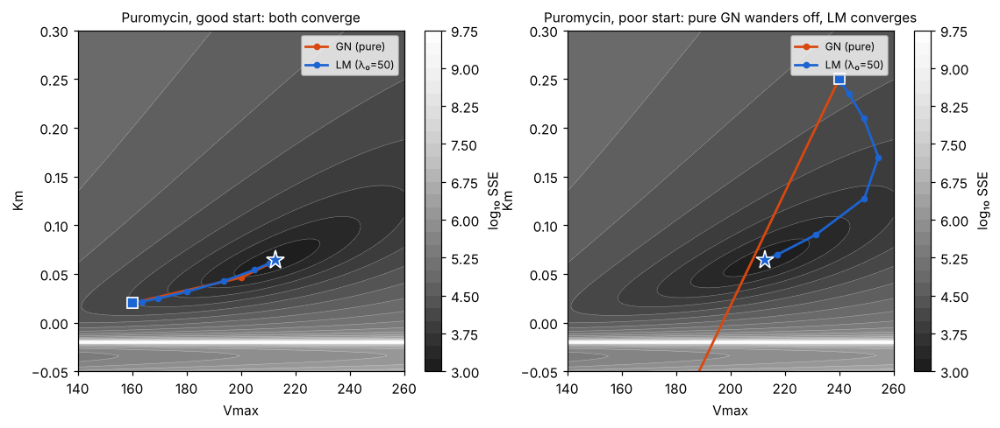
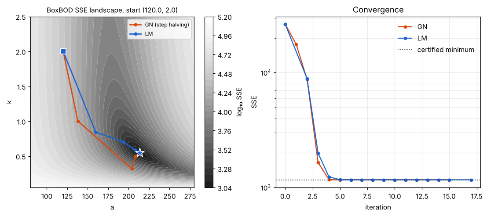
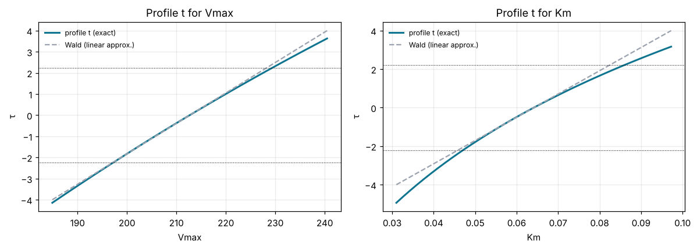

<div align="center">

# Nonlinear Estimation: Gauss–Newton & Levenberg–Marquardt

**Learn, see and use nonlinear least squares.** An interactive solver lab, a tested Python package with full statistical inference, benchmark and sample datasets, and a complete theory guide.

[](https://github.com/lunganlungpg/NL-estimation-/actions/workflows/ci.yml)
[](https://lunganlungpg.github.io/NL-estimation-/)
[](pyproject.toml)
[](#accuracy-on-nist-certified-problems)
[](LICENSE)

### [▶ Open the interactive solver lab](https://lunganlungpg.github.io/NL-estimation-/)



</div>

## Contents

- [What's inside](#whats-inside)
- [Quick start](#quick-start) (Python and R)
- [Gauss–Newton or Levenberg–Marquardt?](#gaussnewton-or-levenbergmarquardt)
- [Accuracy on NIST certified problems](#accuracy-on-nist-certified-problems)
- [Statistical inference](#statistical-inference)
- [Sample datasets](#sample-datasets)
- [Built-in models](#built-in-models)
- [Examples](#examples)
- [API reference](#api-reference)
- [FAQ](#faq)
- [Contributing, citing, license](#contributing)

## What's inside

| | |
|---|---|
| 🧪 **[Interactive solver lab](https://lunganlungpg.github.io/NL-estimation-/)** | Click a starting point on a real SSE landscape and step through **Gauss–Newton** and **Levenberg–Marquardt** side by side. Watch steps get rejected, λ adapt, and the "λ-path" bend from the Gauss–Newton step to steepest descent. Includes a **fit-your-own-data** tool that runs entirely in the browser. |
| 📦 **`nlestim` R package** | The same algorithms for R, with `summary`, `confint` (Wald, profile, bootstrap), `predict`, `anova`, `AIC` methods and **`nl_workflow()`: one call that fits, compares and reports candidate models on any dataset** and exports tables, figures and a report. [R-package/](R-package) |
| 🐍 **`nlsfit` Python package** | Readable implementations of both algorithms (step halving, Marquardt scaling, gain-ratio damping, Bates–Watts convergence test) plus everything you need to report a fit: SE, t and p values, **Wald, profile-likelihood and bootstrap intervals**, confidence and prediction bands, AIC/BIC, nested F-tests, weights, diagnostics plots. |
| 📊 **Sample datasets** | 11 datasets as CSV and one formatted **Excel workbook**: 6 NIST certified benchmarks, the classic Puromycin data, and 4 realistic simulated datasets (crop yield, plant growth, dose–response, drug elimination) with known true parameters. |
| 📈 **Plots** | Fitted curves with bands, residual diagnostics, convergence curves, SSE landscapes with solver paths, profile-t plots. |
| ✅ **Verified** | 49 tests, including agreement with **NIST certified values** to ≥ 6 significant digits and with SciPy. |
| 📚 **[Theory guide](docs/theory.md)** | Derivations, failure modes, damping control, convergence criteria, inference and practical advice, with references. |

```
NL-estimation-/
├── R-package/         # the nlestim R package (workflows, vignettes, tests)
├── nlsfit/            # the Python package
│   ├── solvers.py     #   gauss_newton, levenberg_marquardt, numerical_jacobian, relative_offset
│   ├── fit.py         #   fit(), FitResult (inference, bands, summary), compare(), extra_ss_test()
│   ├── models.py      #   12 models with analytic Jacobians and automatic starting values
│   ├── datasets.py    #   NIST, real and simulated datasets
│   └── plotting.py    #   plot_fit, plot_residuals, plot_convergence, plot_sse_surface
├── site/              # the interactive web lab (plain HTML/JS, deployed to GitHub Pages)
├── data/              # CSV files + nonlinear_datasets.xlsx
├── examples/          # six runnable, documented scripts
├── docs/              # theory guide and figures
├── scripts/           # build_data.py regenerates data/ from the package
└── tests/             # pytest suite
```

## Quick start

```bash
git clone https://github.com/lunganlungpg/NL-estimation-.git
cd NL-estimation-
python -m venv .venv && source .venv/bin/activate      # Windows: .venv\Scripts\activate
pip install -e ".[all]"
python examples/01_quickstart.py
```

Or install directly: `pip install "git+https://github.com/lunganlungpg/NL-estimation-.git"`.

**Fit a model in one line** (this block runs as a test, so it is guaranteed to work):

```python
>>> import nlsfit
>>> data = nlsfit.datasets.load("puromycin")
>>> res = nlsfit.fit(nlsfit.models.michaelis_menten, data.x, data.y)   # starting values are automatic
>>> print(res.summary())                                                # doctest: +ELLIPSIS
Model:   y = Vmax·x / (Km + x)
Method:  levenberg-marquardt (marquardt)
Status:  converged: ...
<BLANKLINE>
             Estimate   Std.Error   t value   Pr(>|t|)   95% CI (Wald)
Vmax          212.684       6.947    30.615   3.24e-11 *** [197.2, 228.16]
Km          0.0641213    0.008281     7.743   1.57e-05 *** [0.04567, 0.082572]
---
Signif. codes: 0 '***' 0.001 '**' 0.01 '*' 0.05 '.' 0.1 ' ' 1
<BLANKLINE>
Residual standard error: 10.934 on 10 degrees of freedom
SSE: 1195.45   R²: 0.9613   AIC: 95.27   BIC: 96.73

```

These match the published values in Bates & Watts (1988) and R's `nls()`.

**Your own function, Gauss–Newton, and profile intervals:**

```python
import numpy as np
import nlsfit


def decay(t, A, k):  # parameter names come from the signature
    return A * np.exp(-k * t)


res = nlsfit.fit(decay, t, conc, p0=[10, 0.3], method="gn")  # "lm" (default), "gn", "gn-pure"
res.conf_int(method="profile")  # or "wald", "bootstrap"
yhat, lo, hi = res.predict(t_new, interval="prediction")
res.to_frame()  # pandas table for reports
```

**In R** (see [`R-package/`](R-package)):

```r
remotes::install_github("lunganlungpg/NL-estimation-", subdir = "R-package", build_vignettes = TRUE)
library(nlestim)
wf <- nl_workflow(plant_growth, x = "day", y = "biomass", output_dir = "results")  # any data frame
fit <- nl_fit(rate ~ conc, puromycin, model = "michaelis_menten")
summary(fit); confint(fit, method = "profile"); plot(fit)
```

**From Excel:**

```python
import pandas as pd, nlsfit

df = pd.read_excel("data/nonlinear_datasets.xlsx", sheet_name="crop_yield_nitrogen")
res = nlsfit.fit("asymptotic_regression", df.iloc[:, 0], df.iloc[:, 1])
```

## Gauss–Newton or Levenberg–Marquardt?

Both repeatedly replace the model with its tangent-plane approximation and solve a linear least-squares problem:

| | Gauss–Newton | Levenberg–Marquardt |
|---|---|---|
| Step | $(J^\top J)\,\delta = -J^\top r$ | $(J^\top J + \lambda D)\,\delta = -J^\top r$ |
| Near the solution | Fastest | Nearly as fast (λ shrinks towards 0) |
| From a poor start | Can overshoot and diverge (step halving helps) | Damping shortens steps and rejects bad ones |
| Singular $J^\top J$ | Fails | Still solvable |
| Used by | R `nls()` (with step halving) | MINPACK, SciPy `curve_fit`, MATLAB `lsqcurvefit`, Origin, Prism |

**Recommendation:** use **Levenberg–Marquardt** by default, then confirm the answer from a second starting point. Neither method always wins: see BoxBOD start 1 below, where Gauss–Newton with step halving succeeds and every LM implementation stalls.



The [theory guide](docs/theory.md) derives both methods, explains damping control and the relative-offset convergence test, and covers inference.

## Accuracy on NIST certified problems

The [NIST Statistical Reference Datasets](https://www.itl.nist.gov/div898/strd/nls/nls_main.shtml) are the standard test for nonlinear regression software: each problem has certified answers and two official starting points (start 1 is far, start 2 is close). Accuracy is the **LRE**, the number of correct significant digits; NIST regards ≥ 6 as a successful solve. Produced by [`examples/06_nist_benchmark.py`](examples/06_nist_benchmark.py):

| Problem (NIST difficulty) | Start | Pure GN | GN + step halving | LM (`nlsfit`) | SciPy MINPACK LM |
|---|---|---|---|---|---|
| Misra1a (lower) | 1 | 11.0 | 9.4 | 8.5 | 7.4 |
| Misra1a (lower) | 2 | 11.0 | 11.0 | 10.7 | 7.7 |
| DanWood (lower) | 1 | 11.0 | 11.0 | 11.0 | 9.4 |
| DanWood (lower) | 2 | 11.0 | 8.7 | 11.0 | 8.7 |
| BoxBOD (higher) | 1 | ✗ diverges | 8.8 | ✗ stalls | ✗ stalls |
| BoxBOD (higher) | 2 | 8.5 | 8.5 | 8.4 | 7.9 |
| Rat42 (higher) | 1 | ✗ | 9.9 | 11.0 | 7.9 |
| Rat42 (higher) | 2 | 11.0 | 9.6 | 10.2 | 8.0 |
| Rat43 (higher) | 1 | ✗ | ✗ | 8.4 | 7.8 |
| Rat43 (higher) | 2 | 8.4 | 8.4 | 8.2 | 7.2 |
| MGH09 (higher) | 1 | ✗ | ✗ | 7.4 | 7.4 |
| MGH09 (higher) | 2 | ✗ local min | 7.3 | 7.3 | 7.4 |
| **Solved (of 12)** | | **7** | **10** | **11** | **11** |

`nlsfit` never reports a failure as success: every ✗ above is flagged `converged=False` with a reason such as `diverged` or `stalled`.

## Statistical inference

A fit is only useful with its uncertainty. `FitResult` provides:

| Need | Call |
|---|---|
| Report table (like R `summary.nls`) | `res.summary()`, `res.to_frame()` |
| Standard errors, covariance, correlation | `res.se`, `res.cov`, `res.corr` |
| Confidence intervals | `res.conf_int(method="wald" \| "profile" \| "bootstrap")` |
| Confidence / prediction bands | `res.predict(x, interval="confidence" \| "prediction")` |
| Goodness of fit | `res.sigma`, `res.r_squared`, `res.aic`, `res.bic` |
| Compare models | `nlsfit.compare(fit1, fit2, ...)`, `nlsfit.extra_ss_test(reduced, full)` |
| Diagnostics | `nlsfit.plotting.plot_residuals(res)` |

Wald intervals assume the model is nearly linear in each parameter. **Profile-likelihood** intervals follow the true shape and can be asymmetric. For Puromycin's $K_m$, the profile interval is [0.0469, 0.0862], longer on the right, against Wald's symmetric [0.0457, 0.0826]:



## Sample datasets

All data are in [`data/`](data) as CSV files and in one Excel workbook, [`data/nonlinear_datasets.xlsx`](data/nonlinear_datasets.xlsx), which contains a README sheet, an index, the NIST certified values with starting points, one sheet per dataset, and a blank template for your own data. In Python: `nlsfit.datasets.load(name)`.

| Dataset | Kind | n | Model | Use it to learn… |
|---|---|---|---|---|
| `misra1a` | NIST | 14 | $a(1-e^{-kx})$ | Parameters on very different scales |
| `boxbod` | NIST | 6 | $a(1-e^{-kx})$ | How Gauss–Newton diverges, and why step halving matters |
| `danwood` | NIST | 6 | $a x^b$ | A gentle first problem |
| `rat42` | NIST | 9 | logistic | Growth curves |
| `rat43` | NIST | 15 | Richards | A 4-parameter growth curve from a poor start |
| `mgh09` | NIST | 11 | rational | Local minima and hard problems |
| `puromycin` | real | 12 | Michaelis–Menten | Inference, profile intervals, bootstrap |
| `crop_yield_nitrogen` | simulated | 21 | Mitscherlich | Replicated agronomic trials, economic optimum, Excel workflow |
| `plant_growth` | simulated | 15 | Gompertz | Model selection with AIC (logistic vs Gompertz vs Richards) |
| `dose_response` | simulated | 18 | 4PL | EC50 estimation |
| `drug_elimination` | simulated | 10 | exponential decay | Multiplicative noise and weighted least squares |

NIST data are public domain. Puromycin is from Treloar (1974) as published by Bates & Watts (1988). Simulated datasets are generated with fixed seeds by `nlsfit/datasets.py`, and their true parameters are listed in the workbook.

## Built-in models

Each has an analytic Jacobian and automatic starting values (except `richards` and `kowalik_osborne`, which need `p0`):

`exponential_decay` · `exponential_rise` · `asymptotic_regression` (Mitscherlich) · `michaelis_menten` · `logistic` · `logistic3` · `gompertz` · `richards` · `four_pl` · `power_law` · `gaussian_peak` · `kowalik_osborne`

Any Python function `f(x, a, b, …)` also works; its Jacobian is then computed by central differences. `x` can be an (n, k) array for models with several inputs.

## Examples

| Script | What it shows | Figure |
|---|---|---|
| [`01_quickstart.py`](examples/01_quickstart.py) | Fit, summary, prediction band | [fit](docs/images/quickstart_fit.png) |
| [`02_gauss_newton_vs_lm.py`](examples/02_gauss_newton_vs_lm.py) | Both methods on BoxBOD and Puromycin, landscapes and convergence | [BoxBOD](docs/images/gn_vs_lm_boxbod.png), [Puromycin](docs/images/gn_vs_lm_puromycin.png) |
| [`03_inference.py`](examples/03_inference.py) | Wald vs profile vs bootstrap intervals, residual diagnostics | [profile t](docs/images/profile_t.png), [residuals](docs/images/residual_diagnostics.png), [bootstrap](docs/images/bootstrap_cloud.png) |
| [`04_model_selection.py`](examples/04_model_selection.py) | Logistic vs Gompertz vs Richards with AIC/BIC | [growth curves](docs/images/model_selection.png) |
| [`05_excel_workflow.py`](examples/05_excel_workflow.py) | Excel in, results workbook out, economic optimum N rate | [yield curve](docs/images/crop_yield_fit.png) |
| [`06_nist_benchmark.py`](examples/06_nist_benchmark.py) | Accuracy table against NIST and SciPy | — |

## API reference

| Function / class | Purpose |
|---|---|
| `fit(model, x, y, p0=None, method="lm", weights=None, jacobian="auto", **options)` | Fit a model; returns `FitResult`. Options include `max_iter`, `rtol`, `lam0`, `tau`, `scaling` (`"marquardt"`/`"levenberg"`), `update` (`"nielsen"`/`"classic"`) |
| `FitResult` | `.params`, `.se`, `.cov`, `.corr`, `.tvalues`, `.pvalues`, `.conf_int()`, `.profile()`, `.bootstrap()`, `.predict()`, `.sigma`, `.sse`, `.r_squared`, `.aic`, `.bic`, `.residuals`, `.fitted`, `.history`, `.converged`, `.summary()`, `.to_frame()`, `res["name"]` |
| `gauss_newton(residual, jacobian, p0, step_halving=True, ...)` | Low-level solver on residual and Jacobian functions |
| `levenberg_marquardt(residual, jacobian, p0, ...)` | Low-level solver |
| `numerical_jacobian(func, theta, method="central")` | Finite-difference Jacobian |
| `compare(*fits)`, `extra_ss_test(reduced, full)` | Model comparison |
| `datasets.load(name)`, `datasets.list_datasets()`, `datasets.log_relative_error()` | Data and NIST accuracy metric |
| `plotting.plot_fit`, `plot_residuals`, `plot_convergence`, `plot_sse_surface` | Figures |

## FAQ

<details><summary><b>Why does my fit not converge?</b></summary>

Usually poor starting values. Plot the data and the curve at `p0`; get starts from a linearising transform; rescale `x` or the parameters; or try `method="gn"` from the LM result, or vice versa. Check `res.solver.message` and `res.history`.
</details>

<details><summary><b>Should I trust R² for nonlinear models?</b></summary>

Not on its own. It is reported for familiarity, but it does not have its linear-regression meaning. Use residual plots, AIC/BIC and the residual standard error.
</details>

<details><summary><b>When are Wald intervals not enough?</b></summary>

When the profile-t plot is curved, or when Wald and profile intervals differ noticeably, which is common with small samples and parameters inside exponentials or denominators. Report profile intervals then.
</details>

<details><summary><b>How does this compare to scipy.optimize.curve_fit?</b></summary>

`curve_fit` wraps MINPACK's Levenberg–Marquardt and returns estimates and a covariance matrix. `nlsfit` gives the same estimates (tested), plus Gauss–Newton, the full iteration history, an honest convergence test, profile and bootstrap intervals, bands, model comparison and readable source code for learning. For large production problems with bounds, use `scipy.optimize.least_squares`.
</details>

<details><summary><b>Can I fit models with several x variables?</b></summary>

Yes: pass `x` as an (n, k) array and write `f(X, *params)` using `X[:, 0]`, `X[:, 1]`, and so on.
</details>

## Development

```bash
pip install -e ".[all]"
ruff check . && ruff format --check .
pytest                       # unit tests + doctests (including this README)
python scripts/build_data.py # regenerate data/ after changing datasets.py
```

To preview the website, open `site/index.html` in a browser. The Pages workflow copies `data/` into the site when it deploys.

## Contributing

Contributions are welcome. See [CONTRIBUTING.md](CONTRIBUTING.md). Good first contributions: more NIST problems (with certified values), more models with analytic Jacobians, translations of the site, and reports of explanations that were unclear.

## Citing

If this helps your research or teaching, please cite it using [CITATION.cff](CITATION.cff) (GitHub shows a "Cite this repository" button).

## License

[MIT](LICENSE). NIST datasets are public domain.
