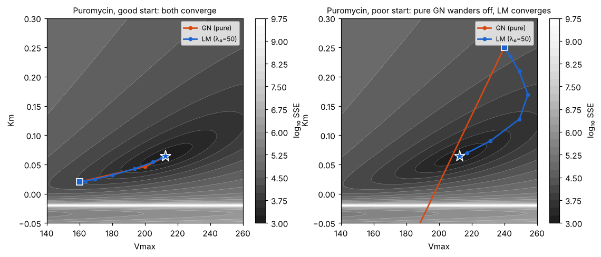
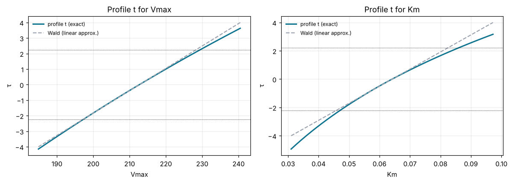

# The theory of nonlinear least squares

A practical guide to Gauss–Newton and Levenberg–Marquardt: where the formulas come from, why they work, and when they fail. Each section points to the code in `nlsfit` that implements it.

## Contents

1. [The problem](#1-the-problem)
2. [Linearisation and the Jacobian](#2-linearisation-and-the-jacobian)
3. [Gauss–Newton](#3-gaussnewton)
4. [Why Gauss–Newton fails](#4-why-gaussnewton-fails)
5. [Levenberg–Marquardt](#5-levenbergmarquardt)
6. [Controlling the damping](#6-controlling-the-damping)
7. [When to stop](#7-when-to-stop)
8. [Statistical inference](#8-statistical-inference)
9. [Practical advice](#9-practical-advice)
10. [References](#10-references)

---

## 1. The problem

We observe pairs $(x_i, y_i)$, $i = 1, \dots, n$, and believe

$$y_i = f(x_i, \theta) + \varepsilon_i, \qquad \varepsilon_i \sim \text{i.i.d. } N(0, \sigma^2)$$

where $f$ is **nonlinear in the parameters** $\theta \in \mathbb{R}^p$. For example, in Michaelis–Menten kinetics $f(x, \theta) = \theta_1 x / (\theta_2 + x)$, the parameter $\theta_2$ appears in a denominator.

The least-squares estimate minimises the residual sum of squares

$$S(\theta) = \sum_{i=1}^n r_i(\theta)^2 = \lVert r(\theta) \rVert^2, \qquad r_i(\theta) = f(x_i, \theta) - y_i.$$

Under normal errors this is also the **maximum-likelihood estimate**, which is why it is the default estimator for nonlinear regression. Unlike linear regression there is no closed-form solution, so we iterate.

## 2. Linearisation and the Jacobian

Near a current guess $\theta$, a first-order Taylor expansion gives

$$f(x_i, \theta + \delta) \approx f(x_i, \theta) + \sum_j \frac{\partial f(x_i, \theta)}{\partial \theta_j} \delta_j,$$

or in matrix form $r(\theta + \delta) \approx r(\theta) + J\delta$, where $J$ is the $n \times p$ **Jacobian**, $J_{ij} = \partial f(x_i, \theta) / \partial \theta_j$.

The gradient and (approximate) Hessian of $S$ follow directly:

$$\nabla S = 2 J^\top r, \qquad \nabla^2 S = 2 J^\top J + 2\sum_i r_i \nabla^2 r_i \approx 2 J^\top J.$$

Dropping the second-derivative term is the key idea: it is small when the residuals are small or the model is nearly linear, and it saves computing second derivatives.

> **In `nlsfit`:** every built-in model has an analytic Jacobian (`nlsfit/models.py`). For your own functions, `numerical_jacobian` uses central differences with step $h = \epsilon^{1/3}\max(|\theta_j|, 1)$, accurate to $O(h^2)$.

## 3. Gauss–Newton

Replace $S(\theta + \delta)$ by its linearised version and minimise over $\delta$:

$$\min_\delta \lVert r + J\delta \rVert^2 \quad\Longrightarrow\quad (J^\top J)\,\delta = -J^\top r.$$

This is an ordinary **linear least-squares problem** at each iteration: regress the residuals on the columns of the Jacobian. The algorithm is:

1. Start at $\theta^{(0)}$.
2. Compute $r$ and $J$ at $\theta^{(k)}$.
3. Solve $\min_\delta \lVert J\delta + r \rVert$.
4. Set $\theta^{(k+1)} = \theta^{(k)} + \delta$ and repeat until converged.

**Numerical note.** Forming $J^\top J$ squares the condition number of $J$ and loses about half the available digits. `nlsfit` solves the least-squares problem directly with an orthogonal factorisation (`numpy.linalg.lstsq`), as good libraries do.

**Convergence rate.** Near the solution, Gauss–Newton converges **quadratically** for zero-residual problems and **linearly** with a rate that depends on the size of the residuals and the curvature of the model otherwise. For well-behaved problems it typically needs 5–15 iterations.

**Step halving (Hartley, 1961).** If the full step increases $S$, try $\delta/2$, $\delta/4$, … until $S$ decreases. Because $\delta$ is a descent direction whenever $J$ has full rank ($\nabla S^\top \delta = -2\, r^\top J (J^\top J)^{-1} J^\top r < 0$), a small enough step always helps. This is the default algorithm of R's `nls()` and `nlsfit.fit(method="gn")`.

## 4. Why Gauss–Newton fails

* **Overshooting.** The linear approximation is only valid locally. Far from the solution the step can be far too long and land in a region where the model behaves completely differently, for example $\exp(-k x)$ with $k < 0$, which explodes. On NIST BoxBOD from start 1, a single pure Gauss–Newton step overflows.
* **Rank deficiency.** If $J$ loses rank, for example when a parameter stops affecting the model, $J^\top J$ is singular and the step is undefined.
* **Large residuals.** The dropped term $\sum r_i \nabla^2 r_i$ matters; convergence becomes slow or fails.
* **Wrong local minimum.** On NIST MGH09, pure Gauss–Newton from start 2 converges to a genuine local minimum with SSE $4.24\times10^{-4}$ instead of the global $3.08\times10^{-4}$.

## 5. Levenberg–Marquardt

Levenberg (1944) and Marquardt (1963) added a damping term:

$$(J^\top J + \lambda D)\,\delta = -J^\top r, \qquad \lambda \ge 0.$$

Equivalently, LM solves the augmented linear least-squares problem

$$\min_\delta \left\lVert \begin{bmatrix} J \\ \sqrt{\lambda D}\end{bmatrix} \delta + \begin{bmatrix} r \\ 0 \end{bmatrix} \right\rVert^2,$$

which is how `nlsfit` computes it, stably.

* **λ → 0:** the Gauss–Newton step.
* **λ → ∞:** $\delta \approx -J^\top r / (\lambda D)$, a short step along (scaled) steepest descent.
* **In between:** a smooth curve of steps. The interactive site draws this "λ-path" from the current point.

**Scaling.** Levenberg used $D = I$. Marquardt's choice $D = \operatorname{diag}(J^\top J)$ makes the method invariant to rescaling the parameters, which matters enormously when parameters differ by orders of magnitude (in Misra1a, $a \approx 239$ and $k \approx 5.5\times10^{-4}$). `nlsfit` uses Marquardt scaling by default (`scaling="marquardt"`) and, like MINPACK, keeps the running maximum of each diagonal entry.

**Trust-region view.** For each λ, the LM step solves $\min \lVert r + J\delta\rVert^2$ subject to $\lVert D^{1/2}\delta \rVert \le \Delta$ for some radius $\Delta(\lambda)$. Increasing λ shrinks the region in which we trust the linear model. Moré (1978) builds the MINPACK implementation on this view.

## 6. Controlling the damping

After computing a trial step, compare the **actual** reduction with the reduction **predicted** by the linear model:

$$\rho = \frac{S(\theta) - S(\theta + \delta)}{S(\theta) - \lVert r + J\delta \rVert^2} = \frac{S(\theta) - S(\theta+\delta)}{-2\delta^\top J^\top r - \lVert J\delta\rVert^2}.$$

* $\rho > 0$: the step reduced $S$. **Accept** it and decrease λ (trust the linear model more).
* $\rho \le 0$: **reject** the step and increase λ.

`nlsfit` offers two update rules:

| `update=` | Accept | Reject |
|---|---|---|
| `"nielsen"` (default; Madsen, Nielsen & Tingleff 2004) | $\lambda \leftarrow \lambda \max\left(\tfrac13, 1-(2\rho-1)^3\right)$, $\nu \leftarrow 2$ | $\lambda \leftarrow \lambda\nu$, $\nu \leftarrow 2\nu$ |
| `"classic"` (Marquardt 1963) | $\lambda \leftarrow \lambda / 10$ | $\lambda \leftarrow 10\lambda$ |

The initial damping is $\lambda_0 = \tau \max_j (J^\top J)_{jj}$ with $\tau = 10^{-3}$, which adapts to the scale of the problem.

## 7. When to stop

Naive tests such as "the step is small" or "S barely changed" can stop prematurely in long, flat valleys, where an algorithm takes many tiny but genuinely useful steps. `nlsfit` uses the **relative offset** criterion of Bates & Watts (1981), which R's `nls` also uses:

$$\text{relative offset} = \sqrt{\frac{\lVert Q_1^\top r\rVert^2 / p}{\lVert Q_2^\top r\rVert^2 / (n-p)}}$$

where $J = Q_1 R$ and $Q_2$ spans the orthogonal complement. The numerator is the part of the residual vector inside the tangent plane of the model surface (which a step can still remove); the denominator is the part orthogonal to it (which no step can remove). At an exact least-squares solution the residual is orthogonal to the tangent plane and the offset is **zero**, regardless of how the parameters are scaled.

`nlsfit` declares convergence when the offset falls below `rtol = 1e-10`. If progress stalls first, it reports **converged** only when the offset is below R's default tolerance of $10^{-5}$, and **stalled** otherwise. A stall is never silently reported as success.

## 8. Statistical inference

At the solution $\hat\theta$, with $s^2 = S(\hat\theta) / (n - p)$:

**Covariance and standard errors** (linear approximation):

$$\widehat{\operatorname{Cov}}(\hat\theta) = s^2 (J^\top J)^{-1}, \qquad \operatorname{SE}(\hat\theta_j) = \sqrt{\widehat{\operatorname{Cov}}_{jj}}.$$

`nlsfit` computes this from the SVD of $J$ for stability. Large correlations between estimates ($|\rho| > 0.95$) signal near-unidentifiability; `summary()` warns about them.

**Wald intervals:** $\hat\theta_j \pm t_{n-p,\,1-\alpha/2}\,\operatorname{SE}_j$. Fast, symmetric, and accurate only when the model is close to linear in $\theta_j$ near the solution.

**Profile-likelihood intervals** (`conf_int(method="profile")`). Fix $\theta_j$ at a value $c$, re-minimise over the other parameters to get $\tilde S(c)$, and define the profile $t$ statistic

$$\tau(c) = \operatorname{sign}(c - \hat\theta_j)\,\frac{\sqrt{\tilde S(c) - S(\hat\theta)}}{s}.$$

The interval is $\{c : |\tau(c)| \le t_{n-p,\,1-\alpha/2}\}$. If $\tau$ is a straight line the Wald interval is exact; curvature means it is not. This is what R's `confint()` reports for `nls` fits.

**Bootstrap intervals** (`conf_int(method="bootstrap")`). Resample centred residuals (inflated by $\sqrt{n/(n-p)}$), add them to the fitted values, refit, and take percentiles. Makes no linearity assumption, at the cost of many refits.

**Confidence and prediction bands** (`predict(x, interval=...)`) use the delta method: with $g = \partial f(x_0, \hat\theta)/\partial\theta$,

$$\operatorname{Var}\!\left[f(x_0, \hat\theta)\right] \approx g^\top \widehat{\operatorname{Cov}}(\hat\theta)\, g,$$

plus $s^2$ for a prediction band (a new observation).

**Model comparison.** For non-nested models use AIC or BIC (`nlsfit.compare`). For nested models use the extra-sum-of-squares F-test (`nlsfit.extra_ss_test`):

$$F = \frac{(S_\text{reduced} - S_\text{full}) / (p_\text{full} - p_\text{reduced})}{S_\text{full} / (n - p_\text{full})}.$$

**Weighted least squares.** If the error variance is not constant, minimise $\sum w_i r_i^2$ with $w_i \propto 1/\operatorname{Var}(y_i)$ (`weights=`). For multiplicative (constant-CV) noise, as in the drug-elimination dataset, $w_i = 1/\hat y_i^2$ is a common choice.

## 9. Practical advice

1. **Plot the data first**, and get starting values from the plot, from a linearising transform (log, reciprocal), or from domain knowledge. The built-in models do this automatically.
2. **Use Levenberg–Marquardt by default.** Confirm the answer from a second starting point or with Gauss–Newton.
3. **Check the diagnostics:** residuals vs fitted (patterns mean a wrong model), Q–Q plot (normality), correlation matrix (identifiability).
4. **Reparameterise** when estimates are highly correlated or on wildly different scales, for example estimate $\log k$ instead of $k$.
5. **Report profile intervals** when Wald and profile intervals disagree noticeably.
6. **Do not trust R²** for model choice in nonlinear regression. Use AIC/BIC, residual plots and subject-matter sense.
7. **Benchmark your software** on NIST StRD problems. Example 06 does this for `nlsfit` and SciPy.

## 10. References

* Levenberg, K. (1944). A method for the solution of certain non-linear problems in least squares. *Quarterly of Applied Mathematics*, 2(2), 164–168.
* Hartley, H. O. (1961). The modified Gauss–Newton method for the fitting of non-linear regression functions by least squares. *Technometrics*, 3(2), 269–280.
* Marquardt, D. W. (1963). An algorithm for least-squares estimation of nonlinear parameters. *Journal of the Society for Industrial and Applied Mathematics*, 11(2), 431–441.
* Moré, J. J. (1978). The Levenberg–Marquardt algorithm: implementation and theory. In *Numerical Analysis*, Lecture Notes in Mathematics 630, 105–116. Springer.
* Bates, D. M. & Watts, D. G. (1981). A relative offset orthogonality convergence criterion for nonlinear least squares. *Technometrics*, 23(2), 179–183.
* Bates, D. M. & Watts, D. G. (1988). *Nonlinear Regression Analysis and Its Applications*. Wiley.
* Seber, G. A. F. & Wild, C. J. (2003). *Nonlinear Regression*. Wiley.
* Madsen, K., Nielsen, H. B. & Tingleff, O. (2004). *Methods for Non-Linear Least Squares Problems* (2nd ed.). Technical University of Denmark.
* Nocedal, J. & Wright, S. J. (2006). *Numerical Optimization* (2nd ed.), chapter 10. Springer.
* NIST Statistical Reference Datasets, Nonlinear Regression. https://www.itl.nist.gov/div898/strd/nls/nls_main.shtml
